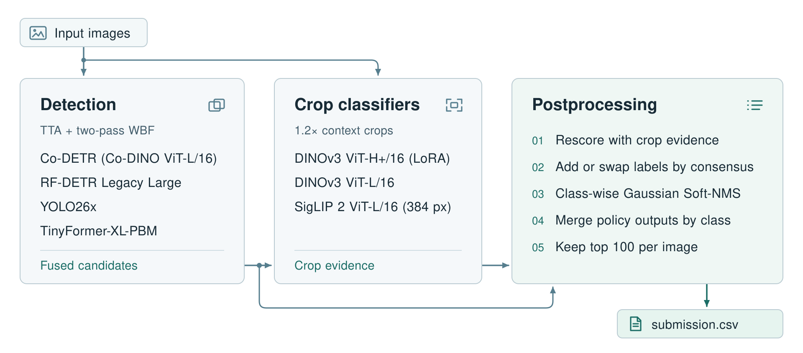
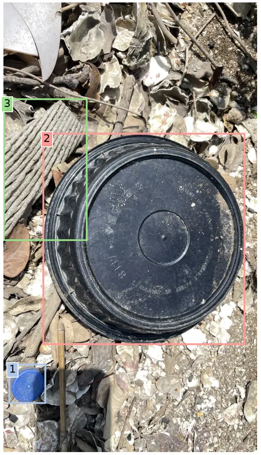
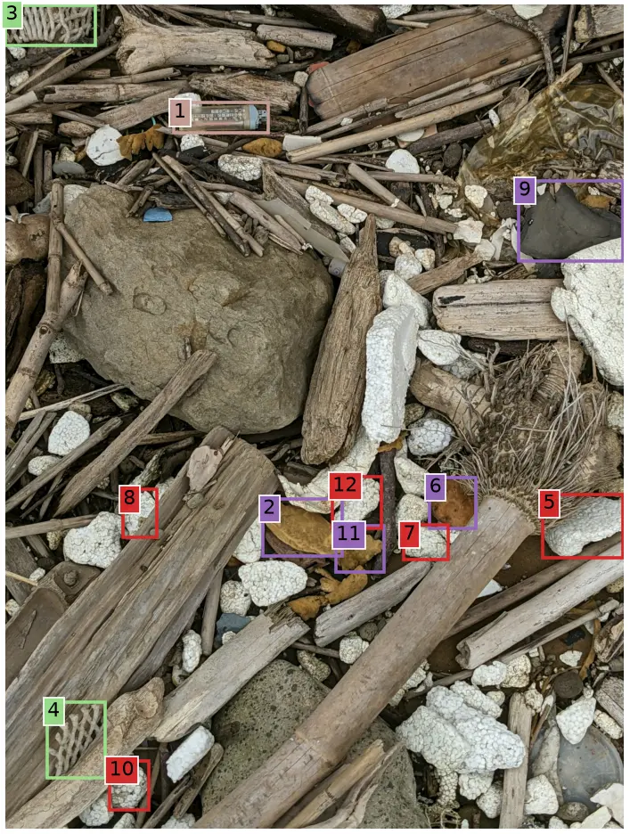

# 🏆 Marine Debris Detection

**First place in detection and lightweight optimization**\
2026 International Marine Debris Image Recognition AI Challenge

Four detectors and three crop classifiers identify 34 types of marine debris.

## Official team results

<div align="center">

| # | Detection (mAP&#64;0.5) | Lightweight (Ω) |
| ---: | :--- | :--- |
| **1** | 金采源是我老婆 &ensp;**0.8159878** | 金采源是我老婆 &ensp;**−20.16** |
| 2 | 我這一生如履薄冰 &ensp;0.8080843 | BlueTrace &ensp;−20.21 |
| 3 | chmod 777 &ensp;0.7991160 | — |

</div>

$$
\Omega = 20\log_{10}\left(\frac{a^2}{\sqrt{p}\sqrt{m}}\right)
$$

Here $a$ is COCO mAP at 0.50 IoU (percent), $p$ is model size (MB), and $m$ is
compute (GFLOPs). [Official results and scoring rules](https://www.aidea-web.tw/topic/6e3adc0a-b9aa-42b7-b73f-80c458e9160a?lang=zh)

## Method

[](assets/pipeline.svg)

Weighted boxes fusion (WBF) combines original and horizontally flipped
predictions per detector in the original image coordinates, then fuses
same-class boxes across detectors. TinyFormer-XL-PBM runs on the original
image alone.

The two DINOv3 classifiers contribute class probabilities and objectness to
rescoring. SigLIP 2 joins them in voting on alternative labels. Label rescue
can add or replace a label while retaining the fused box geometry.

Each policy processes the full candidate bank before contributing detections
for its assigned classes.

## Example predictions

<p align="center">
  
  
</p>

Final predictions on two NAMR training images.
[Box labels, confidences and image credits](assets/examples/README.md)

## Quick start

Use Linux, Python 3.11, a BF16-capable NVIDIA GPU, a C++ compiler and a matching
CUDA toolkit.

```bash
git clone --recurse-submodules https://github.com/ljc-1222/Marine-Debris-Detection-Release.git Marine-Debris-Detection
cd Marine-Debris-Detection
python3.11 scripts/setup_environment.py --cuda auto --codetr
source .venv/bin/activate
```

Download the seven trained checkpoints from
[Hugging Face](https://huggingface.co/ljc-1222/marine-debris-detection).
Put your images in `inputs/images/` and run:

```bash
python -m training.checkpoints download --group final \
  --directory model-release
python -m inference.index --images inputs/images --output inputs/index.json
python -m inference --index inputs/index.json --images inputs/images \
  --checkpoint-root model-release --output-dir outputs/inference
```

Use a new or empty output directory for each run. The pipeline writes
`outputs/inference/final/submission.csv` with one row per detection. Boxes use
top-left XYWH in stored image pixels before EXIF display rotation, and labels
are zero-based in [`categories.json`](configs/categories.json) order.

<details>
<summary>Setup checks, inference options and local AP50</summary>

Set `CUDA_HOME` before setup if `nvcc` is outside `PATH`. Check both
environments after installation.

```bash
python scripts/check_environment.py
python scripts/codetr_python.py scripts/check_environment.py --mode codetr
```

See `python -m inference --help` for options. The default device is `cuda:0`.
Detector and classifier batch sizes default to 1 and 16. Co-DETR always uses
batch size 1. Stage logs are under `logs/` in the output directory.

To score locally, use COCO annotations with matching filenames and pixel
coordinates, and category IDs 1–34. Supply the split and annotation source.

```bash
python -m scoring --annotations inputs/annotations.json \
  --submission outputs/inference/final/submission.csv \
  --split validation --ground-truth-source 'Your validation annotations' \
  --output outputs/ap50.json
```

</details>

## Training

Train on NAMR’s MDImageNet v1.0 using the upstream initializers. The recipes use
mask-based Copy-Paste for Co-DETR, TinyFormer and RF-DETR. The three crop
classifiers train on separate records built from labeled images and detector
proposals. The [training guide](docs/training.md) covers both inputs and the
model exports.

## Contributors

<p align="left">
  <a href="https://github.com/ljc-1222"></a>&ensp;
  <a href="https://github.com/rayyychen"></a>&ensp;
  <a href="https://github.com/DennisRapheal"></a>
</p>

[Licensing and references](THIRD_PARTY_NOTICES.md)
